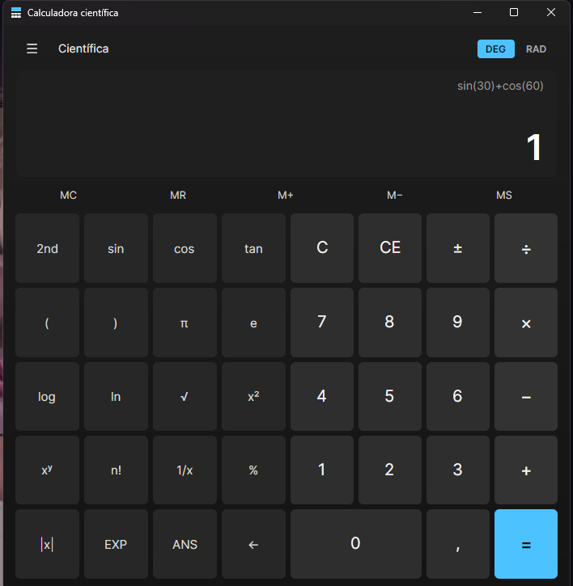

# Calculadora científica

Aplicación de escritorio para Windows inspirada en la calculadora científica del sistema,
construida con **Avalonia UI**, **C#** y **.NET 10**.

Este proyecto nació como una evolución independiente de una calculadora básica de un
laboratorio universitario. El repositorio original no se modifica: todo el desarrollo
ocurre en esta copia.



## Funcionalidades

- Operaciones básicas: suma, resta, multiplicación y división.
- Expresiones completas con paréntesis y prioridad de operaciones.
- Funciones trigonométricas: `sin`, `cos`, `tan`.
- Funciones inversas: `sin⁻¹`, `cos⁻¹`, `tan⁻¹` (botón **2nd**).
- Logaritmos: `log` (base 10) y `ln` (natural); con **2nd**: `10ˣ` y `eˣ`.
- Potencias, raíces cuadradas y cúbicas, cuadrados y cubos.
- Factoriales (`n!`), recíprocos (`1/x`) y valor absoluto (`|x|`).
- Constantes `π` y `e`.
- Modos de ángulo **DEG** y **RAD** con conmutador en la cabecera.
- Porcentajes con la misma semántica que la calculadora de Windows
  (`200 + 10% = 220`, `200 × 10% = 20`).
- Notación científica mediante el botón **EXP** (`1,5 EXP 3 = 1,5 × 10³`).
- Memoria completa: **MC**, **MR**, **M+**, **M−**, **MS**, con indicador `M`.
- Historial de operaciones (hasta 200 entradas), reutilizable con un clic.
- Resultado en vivo mientras se escribe la expresión.
- Manejo de errores matemáticos con mensajes claros: división entre cero,
  dominio inválido, tangente indefinida, factorial no entero, desbordamiento, etc.
- Interfaz oscura moderna, redimensionable y con soporte de teclado.

## Tecnologías

| Componente | Versión |
| --- | --- |
| .NET | 10.0 |
| Avalonia UI | 12.1.0 |
| CommunityToolkit.Mvvm | 8.4.2 |
| xUnit (pruebas) | 2.9.3 |

La aplicación es 100 % local: no requiere conexión a internet ni servicios externos.

## Estructura

```
src/ScientificCalculator/
├── Models/           Motor de expresiones, formateo y errores matemáticos
├── ViewModels/       Estado de la calculadora, memoria e historial (MVVM)
├── Views/            Ventana principal, estilos y entrada por teclado
├── Assets/           Icono de la aplicación
├── App.axaml         Tema y estilos globales
└── Program.cs        Punto de entrada

tests/ScientificCalculator.Tests/   Pruebas del motor y del ViewModel (xUnit)
installer/ScientificCalculator.iss  Script de Inno Setup
scripts/                            Publicación y generación del instalador
```

## Requisitos

- Windows 10 u 11 (x64).
- [.NET 10 SDK](https://dotnet.microsoft.com/download) para compilar y ejecutar desde el código.

Para usar solo el ejecutable publicado no hace falta instalar .NET: la compilación
`win-x64` es autocontenida.

## Ejecutar en desarrollo

```powershell
git clone https://github.com/irina771/scientific-calculator.git
cd scientific-calculator
dotnet run --project src/ScientificCalculator
```

## Pruebas

```powershell
dotnet test
```

La suite cubre el motor de expresiones (precedencia, trigonometría, logaritmos,
factoriales, porcentajes, notación científica y errores) y el comportamiento del
ViewModel (entrada, memoria, historial, modos de ángulo y recuperación de errores).

Estado actual: **87 pruebas superadas**.

## Generar el ejecutable para Windows

```powershell
./scripts/publish.ps1
```

El resultado es un único ejecutable autocontenido en:

```
dist/win-x64/ScientificCalculator.exe
```

También se puede ejecutar el comando directamente:

```powershell
dotnet publish src/ScientificCalculator -c Release -r win-x64 --self-contained true `
  -p:PublishSingleFile=true -p:IncludeNativeLibrariesForSelfExtract=true `
  -p:EnableCompressionInSingleFile=true -o dist/win-x64
```

## Generar el instalador de Windows

1. Instala [Inno Setup 6](https://jrsoftware.org/isinfo.php).
2. Ejecuta:

```powershell
./scripts/build-installer.ps1
```

El script publica la aplicación y compila el instalador en:

```
dist/installer/CalculadoraCientifica-Setup-1.0.0.exe
```

Si `ISCC.exe` no está en el `PATH`, pásalo explícitamente:

```powershell
./scripts/build-installer.ps1 -IsccPath "C:\Program Files (x86)\Inno Setup 6\ISCC.exe"
```

> El instalador no está firmado digitalmente. Windows SmartScreen puede mostrar una
> advertencia al ejecutarlo por primera vez.

## Atajos de teclado

| Tecla | Acción |
| --- | --- |
| `0`–`9`, `.` o `,` | Introducir números y decimales |
| `+` `-` `*` `/` `^` | Operadores |
| `(` `)` | Paréntesis |
| `%` | Porcentaje |
| `!` | Factorial |
| `Enter` | Calcular |
| `Retroceso` | Borrar un carácter |
| `Esc` | Borrar todo |
| `Supr` | Borrar la entrada actual |
| `F9` | Cambiar el signo |

## Limitaciones

- El instalador generado no tiene firma de código.
- La interfaz está en español y usa el punto como separador decimal interno;
  la tecla `,` también se acepta como entrada.
- Las funciones trigonométricas trabajan con precisión de coma flotante de doble
  precisión y redondean el ruido numérico habitual.
- No incluye graficación ni conversión de unidades.

## Origen

Repositorio original (solo lectura, sin modificaciones):
`gitlab.com/jala-university1/.../labs/lab-3/dominguez.irina`.
