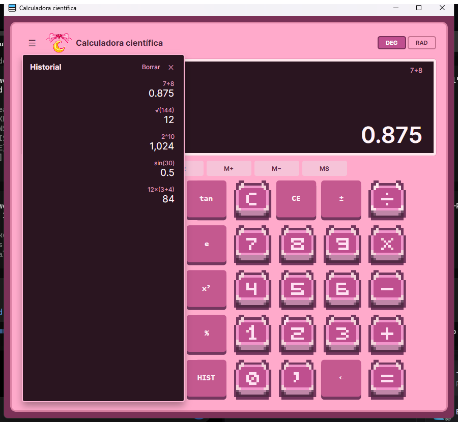

# Calculadora científica

Aplicación de escritorio para Windows inspirada en la calculadora científica del sistema,
construida con **Avalonia UI**, **C#** y **.NET 10**.

Este proyecto nació como una evolución independiente de una calculadora básica de un
laboratorio universitario. El repositorio original no se modifica: todo el desarrollo
ocurre en esta copia.


## Funcionalidades

- Operaciones básicas: suma, resta, multiplicación y división.
- Expresiones completas con paréntesis y prioridad de operaciones.
- Funciones trigonométricas: `sin`, `cos`, `tan`.
- Funciones inversas: `sin⁻¹`, `cos⁻¹`, `tan⁻¹` (botón **2nd**).
- Logaritmos: `log` (base 10) y `ln` (natural); con **2nd**: `10ˣ` y `eˣ`.
- Potencias, raíces cuadradas y cúbicas, cuadrados y cubos.
- Factoriales (`n!`), recíprocos (`1/x`) y valor absoluto (`|x|`).
- Constantes `π` y `e`.
- Modos de ángulo **DEG** y **RAD** con conmutador en la cabecera.
- Porcentajes con la misma semántica que la calculadora de Windows
  (`200 + 10% = 220`, `200 × 10% = 20`).
- Notación científica mediante el botón **EXP** (`1,5 EXP 3 = 1,5 × 10³`).
- Memoria completa: **MC**, **MR**, **M+**, **M−**, **MS**, con indicador `M`.
- Historial de operaciones (hasta 200 entradas), reutilizable con un clic.
- Resultado en vivo mientras se escribe la expresión.
- Al pulsar una función con un número ya escrito, la función envuelve ese valor
  (`30` + `sin` → `sin(30)`) en lugar de concatenar una multiplicación.
- Manejo de errores matemáticos con mensajes claros: división entre cero,
  dominio inválido, tangente indefinida, factorial no entero, desbordamiento, etc.
- Interfaz pastel pixel art basada en los recursos gráficos originales,
  redimensionable y con ventana compacta de 447×680 px.

### Historial y memoria



## Distribución tipo Windows Calculator

La ventana mide **447×680 px**, del tamaño de la calculadora de Windows en
modo científico (measureado con UIA: ventana de 447×680, botones numéricos
aproximadamente de 52×44).

Estructura de la calculadora:

- **Pantalla de resultados** (línea superior).
- **Fila de memoria** `MC MR M+ M− MS` centrada.
- **Teclado**: 8 columnas × 5 filas en un `Viewbox` de 432×240 px:
  - Panel científico (cols 0-3): `2nd`, `sin`, `cos`, `tan`, `(`, `)`, `π`, `e`,
    `log`, `ln`, `√`, `x²`, `xʸ`, `n!`, `1/x`, `%`, `|x|`, `EXP`, `ANS`, `HIST`.
  - Panel estándar (cols 4-7): `C`, `÷`, `7`, `×`, `8`, `,`, `9`, `←`,
    `4`, `5`, `6`, `−`, `1`, `2`, `3`, `+`, `0`, `×`, `CE`, `=`.
- **DEG/RAD** y el botón de historial en la cabecera.

Todas las funciones de antes se conservan; añadimos algunas funciones adicionales
para poblar las columnas vacías (`EXP`, `ANS`, `HIST`, `CE`).

## Identidad visual y assets originales

La interfaz recupera el pixel art del proyecto original (rosa `#FFAACB`, bordes
`#D980A2` y teclas magenta `#BF4F8F`) y lo integra en los controles reales de Avalonia,
con la paleta kawaii Strawberry Milk (`#FDCDEA`, `#FDB0DF`, `#401E34`, `#6F3563`).

**Assets encontrados en el repositorio original** (carpeta `Assets/`):

| Asset | Tamaño | Uso actual |
| --- | --- | --- |
| `normal_0..9_btn.png` (10) | 80×80 | Teclas numéricas, dibujadas 1:1 en celdas de 52×44 |
| `normal_+ - x divide = c ,_btn.png` (7) | 80×80 | Operadores, `C`, coma y `=` |
| `pressed_*_btn.png` (19) | 80×80 | Pulsación de las teclas estándar (se recuperaron en `Assets/Original/Pressed/`) |
| `sailor-icon.png` | 448×346 | Logo de la cabecera |
| `fondo_calculadora.png` | 370×605 | Referencia de paleta del cuerpo |
| `pantalla.png` | 265×105 | Referencia de paleta del bisel de la pantalla |
| `avalonia-logo.png` / `.ico` | 770×720 | Branding del framework, no del proyecto |
| `normal_est_btn.png`, `normal_hex_btn.png` | 105×80 | Botones de otro modo, obsoletos aquí |
| `icon_calculator.png` | 80×80 | Icono de la calculadora para la barra de título (Aseprite) |
| `normal_2nd_btn-export.png` | 80×80 | Botón 2nd exportado (Aseprite) |
| `normal_%_btn-export.png`, `normal_exp_btn-export.png` | 80×80 | Botones `mod` y `exp` exportados (Aseprite) |
| `fondo-export.png` | 1600×2600 | Fondo rosa y crema diseñado en Aseprite (kawaii, Added Wed Nov 2026) |
| `pantalla-export.png` | 1320×410 | Pantalla de resultados diseñada en Aseprite (colores oscuros de fondo de pantalla) |

Todos los archivos se conservan en `src/ScientificCalculator/Assets/Original/` y se
empaquetan como recursos del ejecutable.

**Recuperados e integrados visiblemente:** las 17 teclas estándar (números,
operadores, `C`, coma, `=`), el logo `sailor-icon.png` y el icono propio de la
aplicación (`Assets/app.ico`, se mantiene en lugar del logo de Avalonia).
Las teclas científicas, de memoria y `CE`/`±`/`←` usan un bisel equivalente dibujado
en XAML (mismo magenta, sombra inferior y tipografía monoespaciada) para poder mostrar
textos dinámicos como `sin⁻¹` o `10ˣ`.

**Faltantes o incompatibles:**

- No hay archivos de fuentes: el texto original está rasterizado dentro de los PNG,
  así que la interfaz usa `Consolas` para conservar el aire pixelado.
- `pantalla.png` y `fondo_calculadora.png` son imágenes de 265×105 y 370×605 con
  bordes escalonados: al estirarlas para una ventana redimensionable a 8 columnas se
  rompen sus biseles, así que el bisel de la pantalla y el marco del cuerpo se
  reconstruyeron en XAML con sus mismos colores (`#FFE7ED`, `#D980A2`, `#2A1520`).
- `normal_est_btn.png` y `normal_hex_btn.png` corresponden a un modo de la versión
  original que no existe en esta calculadora (DEG/RAD se controla en la cabecera).
- `avalonia-logo.*` es el logo de Avalonia, no del proyecto: se conserva el icono
  propio `Assets/app.ico`.

**Distribución:** el teclado se organiza en una rejilla fija de 8×5 celdas de 90 px
dentro de un `Viewbox`, de modo que las teclas mantienen su tamaño relativo y su
alineación al cambiar el tamaño de la ventana.

## Tecnologías

| Componente | Versión |
| --- | --- |
| .NET | 10.0 |
| Avalonia UI | 12.1.0 |
| CommunityToolkit.Mvvm | 8.4.2 |
| xUnit (pruebas) | 2.9.3 |

La aplicación es 100 % local: no requiere conexión a internet ni servicios externos.

## Estructura

```
src/ScientificCalculator/
├── Models/           Motor de expresiones, formateo y errores matemáticos
├── ViewModels/       Estado de la calculadora, memoria e historial (MVVM)
├── Views/            Ventana principal, estilos y entrada por teclado
├── Assets/           Icono de la aplicación y PNG originales (Assets/Original)
├── App.axaml         Tema y estilos globales
└── Program.cs        Punto de entrada

tests/ScientificCalculator.Tests/   Pruebas del motor y del ViewModel (xUnit)
installer/ScientificCalculator.iss  Script de Inno Setup
scripts/                            Publicación y generación del instalador
```

## Requisitos

- Windows 10 u 11 (x64).
- [.NET 10 SDK](https://dotnet.microsoft.com/download) para compilar y ejecutar desde el código.

Para usar solo el ejecutable publicado no hace falta instalar .NET: la compilación
`win-x64` es autocontenida.

## Ejecutar en desarrollo

```powershell
git clone https://github.com/irina771/scientific-calculator.git
cd scientific-calculator
dotnet run --project src/ScientificCalculator
```

## Pruebas

```powershell
dotnet test
```

La suite cubre el motor de expresiones (precedencia, trigonometría, logaritmos,
factoriales, porcentajes, notación científica y errores) y el comportamiento del
ViewModel (entrada, memoria, historial, modos de ángulo y recuperación de errores).

Estado actual: **89 pruebas superadas**.

## Generar el ejecutable para Windows

```powershell
./scripts/publish.ps1
```

El resultado es un único ejecutable autocontenido en:

```
dist/win-x64/ScientificCalculator.exe
```

También se puede ejecutar el comando directamente:

```powershell
dotnet publish src/ScientificCalculator -c Release -r win-x64 --self-contained true `
  -p:PublishSingleFile=true -p:IncludeNativeLibrariesForSelfExtract=true `
  -p:EnableCompressionInSingleFile=true -o dist/win-x64
```

## Generar el instalador de Windows

1. Instala [Inno Setup 6](https://jrsoftware.org/isinfo.php).
2. Ejecuta:

```powershell
./scripts/build-installer.ps1
```

El script publica la aplicación y compila el instalador en:

```
dist/installer/CalculadoraCientifica-Setup-1.0.0.exe
```

Si `ISCC.exe` no está en el `PATH`, pásalo explícitamente:

```powershell
./scripts/build-installer.ps1 -IsccPath "C:\Program Files (x86)\Inno Setup 6\ISCC.exe"
```

> El instalador no está firmado digitalmente. Windows SmartScreen puede mostrar una
> advertencia al ejecutarlo por primera vez.

## Atajos de teclado

| Tecla | Acción |
| --- | --- |
| `0`–`9`, `.` o `,` | Introducir números y decimales |
| `+` `-` `*` `/` `^` | Operadores |
| `(` `)` | Paréntesis |
| `%` | Porcentaje |
| `!` | Factorial |
| `Enter` | Calcular |
| `Retroceso` | Borrar un carácter |
| `Esc` | Borrar todo |
| `Supr` | Borrar la entrada actual |
| `F9` | Cambiar el signo |

## Limitaciones

- El instalador generado no tiene firma de código.
- La interfaz está en español y usa el punto como separador decimal interno;
  la tecla `,` también se acepta como entrada.
- Las funciones trigonométricas trabajan con precisión de coma flotante de doble
  precisión y redondean el ruido numérico habitual.
- No incluye graficación ni conversión de unidades. Se evaluó un modo gráfico, pero
  el motor de expresiones no maneja variables (`x`) y añadirlo habría supuesto un
  segundo evaluador; se prefirió mantener la calculadora científica simple y fiable.

## Origen

Repositorio original (solo lectura, sin modificaciones):
`gitlab.com/jala-university1/.../labs/lab-3/dominguez.irina`.
